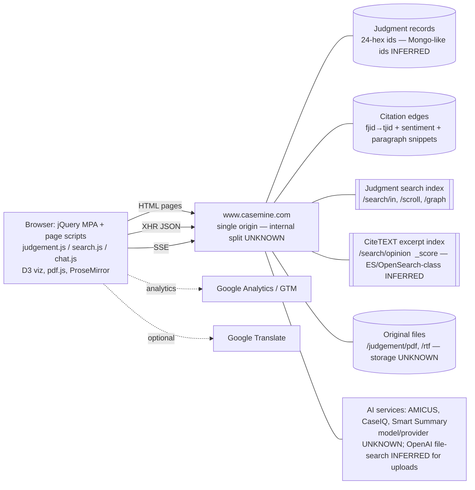
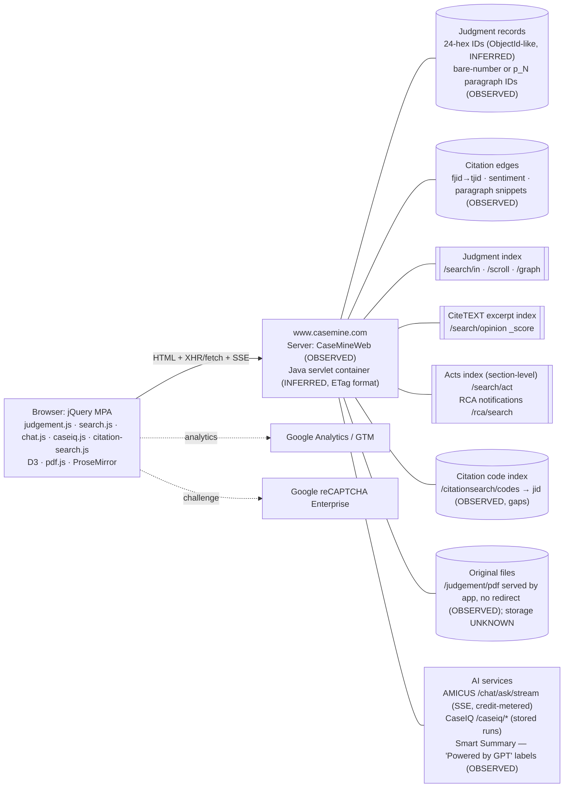

# CaseMine: evidence-based architecture reconstruction

**Investigation date:** 2026-10-17
**Tooling:** REA `rea-agents` 6.5.0 (MCP), one isolated debug Chrome, local static analysis
**Evidence:** `evidence/raw/` (gitignored). The ledger is [evidence-ledger.md](evidence-ledger.md).

**Classification key**
- **OBSERVED**: seen directly in a captured response, the DOM or accessibility tree, or shipped JavaScript.
- **INFERRED**: a supported interpretation that was not proven.
- **UNKNOWN**: not established.

**Scope note.** Most captures after the homepage were made in a session the operator logged into themselves. What is reported here is what a logged-in subscriber's browser receives, not what an anonymous visitor sees. Account identifiers seen in captures (user ID, institution, licensee name, recent searches) are deliberately left out of this report.

---

## Executive summary

1. **Judgments are keyed by a 24-hex ID that looks like a MongoDB ObjectId.**
   - The ID is used the same way in page URLs (`/judgement/in/{id}`), citation records (`jid`), search results (`id`) and graph edges (`id1`/`id2`). OBSERVED.
   - The ID's leading 4 bytes, read as a Unix timestamp, are never earlier than the judgment date in 110 of 110 records; the median is 6 days later. That suggests IDs are minted at ingestion. INFERRED, high confidence.
   - A search-record field is literally named `recordInMongo`. OBSERVED name; MongoDB use is INFERRED.
2. **Citations are first-class, directed edge records.**
   - Shape: `{id, fjid, tjid, sentiment, snippet[{pid[], opinion}], reason, snippet_span, eBy, eByName, eAt}`. OBSERVED.
   - `fjid` is always the citing judgment and `tjid` the cited one. Both directions are exposed by separate endpoints (`linkDetails` for outgoing, `citeText` for incoming). OBSERVED.
   - Each edge carries one treatment label from `positive`, `referencing`, `distinguished`, `overruled`, `negative` (OBSERVED values). It also carries the citing judgment's paragraph IDs and an HTML excerpt.
3. **Treatment is rolled up onto the judgment.** Search records carry `ovrRuled`, `sentimentCategory` (`negative`/`overruled`), and `sentimentIds`/`sentimentTitle` naming the judgments that applied that treatment. OBSERVED.
4. **Search uses two separate hit spaces with Lucene-style traits.**
   - A judgment index is served as a server-rendered page plus `/search/scroll` and `/search/graph`. A citation-excerpt ("CiteTEXT") index is served by `/search/opinion?sort=_score`. They return different hit counts and record shapes for the same query. OBSERVED.
   - `_score` sorting, `<em>` highlighting and token-by-token matching of `(2021) 2 SCC 1` (1,440,078 hits) point to an Elasticsearch/OpenSearch-class engine. INFERRED, medium confidence; not proven.
   - Repeating an identical query gave the same hit count but a different top 10. OBSERVED.
5. **AMICUS (AI) is a credit-metered, server-streamed RAG-style chat with judgment-anchored citations.** One question was submitted, with the operator's approval.
   - The request was `POST /chat/ask/stream` with `question, country, effort, verb, caseId`. OBSERVED.
   - The SSE stream announced five stages: understanding the question and expanding terms, semantic knowledge-base search, judgment and authority search, citation collection, then answer generation. OBSERVED as server-declared labels; the implementation behind them is UNKNOWN.
   - The streamed answer cites `/judgement/in/{id}#p_{n}` links inline and ends with a "References" list giving each authority's "Proposition relied on" and "Applicability". OBSERVED.
   - A spot check of the 3 paragraph-anchored citations found the right judgment each time but the **wrong paragraph** each time. The supporting text sits elsewhere in the same judgment. OBSERVED.
   - The model provider for these answers is UNKNOWN. The uploaded-document path maps files to `openaiFileId` and `vectorStoreId`, so OpenAI is INFERRED as the provider for that feature only.
6. **Judgment pages carry an AI-style "Smart Summary".** It has fixed sections, including a "Table of Precedents Cited" with "Rule or Principle Cited For". It is generated on demand by `GET /judgement/{c}/{id}/summary/generate`. OBSERVED. The generation method is UNKNOWN.
7. **The frontend is a server-rendered multi-page app.** It uses jQuery 3 with page-specific scripts (`judgement.js`, `search.js`, `chat.js`), D3 for graphs and pdf.js for original PDFs, with no source maps. Every API call observed is same-origin on `www.casemine.com`; the only third-party origins are Google Analytics/Tag Manager and Google Translate. OBSERVED. No backend service boundaries are visible behind that single origin. UNKNOWN.

---

## Q1. How are documents represented and associated with metadata?

| Aspect | Finding | Class | Evidence |
|---|---|---|---|
| Canonical document URL | `/judgement/{country}/{id24}`, with `country=in` for India | OBSERVED | EV-04, EV-06 |
| Rendered text | Server-rendered HTML in the page document (over 64 KiB); paragraphs addressed as `p_{n}` anchors (e.g. `#p_377`) | OBSERVED | EV-04 (DOM links), `citedParas` keys |
| Original document | `GET /judgement/pdf/{c}/{id}`, rendered client-side by pdf.js 2.0.7; RTF fallback `/judgement/rtf/{c}/{id}` when `fileFormat=='rtf'` ("PDF unavailable") | OBSERVED | `judgement.js` L17, L94–118, L211; EV-08 step 3 |
| Separate content API | `GET /judgement/{c}/{id}/content` returns `{content}`, used by `loadUkJudgement` (UK path) | OBSERVED (code only; not fired for an India judgment) | `judgement.js` L220 |
| Page-embedded metadata | `judgementId, judgementTitle, judgementStitle, judgementDate, judgementCourt, judgementYear, citedByCount, paraIds, has_summary, is_order, fileFormat, loadPdf, free_access, search_type, sensitive` | OBSERVED | inline script, EV-04 export |
| Ingestion-quality flags | Search records carry `scanned`, `junk`, `rlang`, `table`, `ai`, `order`, `ur`, `noIndex`, `sensitive` | OBSERVED names; all `false` in 110 records except `ur` (1 true) | `/search/scroll`, `/search/graph` bodies |
| Meaning of those flags | `scanned` suggests an OCR/scan marker. `noIndex` matches the published search-engine de-indexing policy. `sensitive` matches the stated matrimonial and child-custody handling. | INFERRED (names plus policy text) | EV-14 policy page |
| Provenance | Policy: judgments are reproduced "verbatim… as issued by the courts", with no redaction except by court order | OBSERVED (policy statement, not technical proof) | EV-14 |
| Storage technology | — | UNKNOWN | — |

## Q2. Which judgment fields and identifiers have been observed?

### Identifier
- A 24-character lowercase hex `id`/`jid`. It is the same value in the URL, inline `judgementId`, `linkDetails.fjid/tjid.jid`, `/search/*` `id`, graph `id1/id2` and `sentimentIds[]`. OBSERVED across EV-04, EV-06, EV-08 and the CDP bodies.
- The ID's timestamp prefix trails the judgment date (median 6 days, never negative, n=110). That is consistent with ObjectIds minted at ingestion. INFERRED.
- The citation edge `id` and the AMICUS IDs (`chatId`, `qaId`) are separate ID spaces.

### Judgment summary object embedded in citation edges (OBSERVED)
`{jid: str, title: str, date: int (epoch ms), courtName: str, year: int, courtFlag: int, judgmentDate: str "14 Dec 2020", pid: null, sentiment: null, score: null}`.
This is a projection used inside edges, not the full record.

### Search-record projection (OBSERVED keys from `/search/scroll` and `/search/graph`)
`id, title, shortTitle, courtName, displayCourtName, courtBench, judgeName, numberOfjudgeName, date, month, year, monthYear (decimal year), caseNumber, caseNumberString, citationCodes[], nCitation, eqCodeLong, acts, advocates, dockets, disposition, motions, highlightedMotions, content (highlighted snippet), abs, impParas, opinions, commentaryId, citesToCount, citedByCount, ovrRuled, sentimentIds[], sentimentTitle[], sentimentCategory, prio, isTribunal, order, ur, scanned, junk, rlang, table, ai, noIndex, sensitive, webUrl, newId, bookmarked, userQueriesPlus[]`.

Several of these (`judgeName`, `caseNumber`, `citationCodes`, `nCitation`, `acts`, `advocates`) were null or empty in all 110 records, even though the judgment page displays judges, case number and neutral citation. So the search projection is sparser than the page. OBSERVED.

### Judgment page display labels (OBSERVED in the accessibility tree)
- "Neutral Citations" (e.g. `2026 INSC 5`), "Equivalent Citations", "Case Number" (e.g. `C.A. No.-000036-000036 - 2026`), "Disposition" (`Allowed`), "Advocates", "Judges".
- Statute mentions (e.g. "Section 11(6-A)… Arbitration Act").
- Smart Summary sections: Factual and Procedural Background; Legal Issues Presented; Arguments of the Parties; Table of Precedents Cited (with "Rule or Principle Cited For"); Court's Reasoning and Analysis; Holding and Implications.

### Unexplained field
`prio` takes values {0, 50, 60, 80, 100} and does not map one-to-one to court. Supreme Court records appear with 50, 80 and 100. UNKNOWN meaning.

## Q3. How are citation edges represented, directed and connected?

All of the following is OBSERVED from four response bodies: the outgoing and incoming lists for two judgments.

```
edge = {
  id:        24-hex           // edge identity, distinct from judgment ids
  fjid:      JudgmentStub     // citing ("from") judgment
  tjid:      JudgmentStub     // cited ("to") judgment
  sentiment: "positive" | "referencing" | "distinguished" | "overruled" | "negative"
  snippet:   [{ pid: ["p_46", …],      // paragraph ids in the CITING judgment
                opinion: "<span>…</span>", // HTML excerpt(s) of the citing text
                groupId, length }]
  reason, snippet_span, eBy, eByName, eAt   // null in every observed edge
}
```

**Direction is consistent.**
- In `GET /judgement/{c}/{id}/linkDetails`, every edge has `fjid == page`: these are the judgments this one cites. 10 of 10 for the Motilal Oswal judgment, 48 of 48 for Vidya Drolia.
- In `GET /judgement/{c}/{id}/citeText`, every edge has `tjid == page`: these are the judgments citing this one. 100 of 100 for Vidya Drolia.

**Both directions are exposed, with paging.**
- `citeText` returned `citedByListSize: 1288`, but only the first 100 items in `citesByList` and the first 10 in `opinionList`.
- Further pages come from `/citeText/scroll`. `opinionMap` is a year histogram (`{"2021":103,…,"2026":399}`).
- The Motilal → Vidya Drolia edge is in Motilal's outgoing list but was not in the first 100 incoming edges for Vidya Drolia, so reciprocity is unverified (UNKNOWN). Confirming it needs paging through `/citeText/scroll` or the `query` filter.

**Edge endpoints are canonical judgments.** Stubs carry `jid`. Clicking a graph node opens `/judgement/{c}/{id}` (`judgement.viz.js` L407). In-text links in judgment HTML also point to `/judgement/in/{id}`. OBSERVED.

**Paragraph granularity.**
- `GET /judgement/citedParas?judgementId=&country=` returns `{p_n: count}` for the *cited* judgment. It drives a per-paragraph heat map and "click to see multiple interpretations" badges. OBSERVED (EV-08 and `judgement.js` L331–370).
- `snippet.pid` refers to the *citing* judgment's paragraphs. INFERRED from paragraph numbers that exceed the cited judgment's length, e.g. p_793.

**Graph reconstruction.**
- `citesToGraphList` and `citesByGraphList` are JSON-encoded strings holding the same edge objects.
- `/search/graph` returns up to 100 result nodes plus `citedByLines[{id1,id2,x1,x2,y1,y2,sentimentPresent,…}]`. All 643 lines connect nodes within that result set, so it is an induced subgraph laid out by year (`x` is a decimal year).
- So the visible graph can be reconstructed from observed nodes and edges. OBSERVED.

**Count inconsistency.** Vidya Drolia shows `citedByCount` 1,173 in search but `citedByListSize` 1,288 in `citeText`. OBSERVED contradiction; perhaps a stale denormalized counter (INFERRED).

**Storage engine.** UNKNOWN. Nothing observed shows a graph database; the API serves adjacency lists and induced subgraphs.

## Q4. What do the sentiment values mean?

The vocabulary is OBSERVED: `positive`, `referencing`, `distinguished`, `overruled`, `negative`. A missing value renders as "uncategorized" (`judgement.js` L647–660).

Reading the snippets against their labels (INFERRED, medium confidence):
- **positive**: followed or relied on, e.g. "In Duro Felguera … this Court held".
- **referencing**: cited or mentioned without evaluation.
- **distinguished**: the citing court separated the cited case on its facts or law.
- **negative**: reliance criticized, e.g. "reliance … was untenable".
- **overruled**: the cited case is described as overruled. In the Motilal edges to Himangni and SBP & Co. the label records the *status discussed in the text*. It does not mean the citing judgment itself overruled them. Treat `overruled` as "overruled (possibly by another court)" unless verified.

**Labelling method.** UNKNOWN. The editor fields `eBy`/`eByName`/`eAt` exist but were null on every edge. That suggests a provision for manual overrides on top of machine labels (INFERRED). Labels apply per edge, not per paragraph.

**Roll-up to judgments.** In search records, `sentimentCategory` (`negative`/`overruled`), `ovrRuled` and `sentimentIds` point to the treating judgments. That is a precomputed "red flag" on the judgment. OBSERVED fields; denormalization INFERRED. `/judgement/overRuled/{c}/{id}` returns `{sids[], sTitles[]}` (code only).

## Q5. What are the observable search request and response structures?

| Step | Request | Response | Class |
|---|---|---|---|
| Autosuggest (≥3 chars, 500 ms debounce) | `GET /search/autosuggest?searchfield=` (and `/search/autosuggest/judgename`) | `[{label, value, category}]`; category `Judgements:` gets a gavel icon | OBSERVED (empty list for the test query) |
| Submit | Form `#search-form-main` navigates to `/search/{country}/{query}`. The query is sanitized (`/`→`(SLASH)`, `%`→`(PERCENTAGE)`, `?`→`(QUESTION)`, `.`→`(DOT)`, `#`→`(HASH-SYM)`) and given a scope prefix (`parallel:`, `title:`, `appellant:`, `respondent:`, `lawyer:`) | Server-rendered HTML with the first 20 judgments | OBSERVED |
| Result tabs | — | Judgments (13,753 for the test query), CiteTEXT, Acts, Commentaries, Columns, Visual, RCA, Alerts; sort "Relevance"; "Run CaseIQ" | OBSERVED (accessibility tree) |
| Page 2+ | `GET /search/scroll?start=20&from=false&isTribunal=0`, with **no query parameter** | `{result[10 × search record], hits, allCourts[64], allCourtsMap{court: count}, …buckets}` | OBSERVED; server-side query state INFERRED |
| Citation excerpts | `GET /search/opinion?start=0&sort=_score&query=` | `{result[10 × {id, fjidId, fjidTitle, fjidCourtName, tjidId, tjidTitle, tjidCourtName, fpid, tpid, snippet[html with <em>]}], hits}` | OBSERVED |
| Visual | `GET /search/graph?query=` | Up to 100 result records, `citedByLines[]`, `allYearsBucket{year: n}` | OBSERVED |
| Other routes in code | `/search/act`, `/commentary/search/`, `/column/search/`, `/rca/search/in/`, `/search/briefs`, `/search/suggestion`, `/search/citedByLines`, `/search/applyCIQ` | — | OBSERVED (code only) |

**Retrieval behaviour (do not over-read).**
- The citation string `(2021) 2 SCC 1` was matched token by token, with each token highlighted, and returned 1,440,078 excerpt hits. Through this route it was a lexical query, not exact-citation resolution. OBSERVED.
- Exact or parallel citation lookup probably uses the `parallel:` scope. INFERRED; untested.
- The same keyword query twice gave `hits` 2,869 both times but a different top 10, with field diffs and the `tpid` format changing between `"39"` and `"p_18"`. Ranking isn't deterministic across calls. OBSERVED; the cause is UNKNOWN.
- Semantic or vector retrieval in search: no evidence either way. UNKNOWN.

## Q6+. AI and RAG pipeline (layer 5)

| Stage | Finding | Class |
|---|---|---|
| Entry points | `/chat` (AMICUS); `/caseiq`; "Run CaseIQ" and "Ask AMICUS!" banners injected into search results (`search.js` L3623–3647). The judgment page's CaseIQ tab only swaps a promo image (`judgement.js` L615); no request was observed (EV-07). | OBSERVED |
| Question submission (live) | `POST /chat/ask/stream`, form-encoded `question=…&country=in&effort=3&verb=2&caseId=`; response `text/event-stream`. Code also has `POST /chat/ask`, `GET /chat/ask/stream?{qs}` (EventSource), upload variants `/chat/upload/ask(/stream)`, drafting `/ai/draft/*` and `/chat/promptEnhance` | OBSERVED (EV-17; code) |
| Stream protocol (live) | `: connected`, then 5 × `event: status {code, message}`, then unnamed `data:` lines carrying answer HTML/markdown deltas, then `event: final {id, chatId, chatLeft, limitMessage, mode, credits, walletUsed, walletBalance, fileSearch, webSearch, fileSearchSources, webSearchSources, fileStatusMap}`, then `event: done {}` | OBSERVED |
| Declared stages | `understanding_question` ("expanding search terms") → `searching_semantic` ("Searching the knowledge base") → `searching_authorities` ("Searching judgments and authorities") → `collecting_citations` → `generating_answer` | OBSERVED as labels. Retrieval method behind them UNKNOWN; "semantic" suggests embedding retrieval (INFERRED, low-medium) |
| Answer structure (live) | "Answer:" with numbered propositions, each followed by `cite<a href="/judgement/in/{id24}[#p_n]">Title</a> (citation, court, year)`; then "References:" with Title, citation, court, year, Date, "Proposition relied on" and "Applicability" per authority | OBSERVED |
| Source grounding | All 5 inline citations resolve to canonical judgment ids, 3 with paragraph anchors (`#p_523`, `#p_15`). 4 distinct authorities. Web and file sources null (`webSearch: 0`). | OBSERVED (link targets); anchor accuracy checked below |
| Paragraph-anchor accuracy (2 anchored authorities checked) | **Right authority, wrong paragraph in both.** Details in the table below. | OBSERVED (paragraph text read from the loaded pages) |
| Conversation state | Navigation to `/chat/{chatId}`; `GET /chat/meta/{chatId}` returns `{id, title, productType:"AMICUS", status, publicId, createdAt, country, skill:"chat", vectorStoreId:null, vectorStoreStatus:0, fileTokens:0, …}` | OBSERVED |
| Uploaded-document retrieval | `fileSearchSources[].file_id` mapped to `openaiFileId`; per-chat `vectorStoreId`/`fileTokens` | OBSERVED (code and meta field names); an OpenAI vector store and file search INFERRED for uploads only |
| Model for normal answers | — | UNKNOWN |
| Metering | `final.chatLeft` and `limitMessage` (trial package credits) decremented by this question | OBSERVED (values withheld) |

The pipeline, with each stage labelled:

`Question → (OBSERVED) POST /chat/ask/stream → (OBSERVED label) query understanding and term expansion → (OBSERVED label; method UNKNOWN) semantic knowledge-base search → (OBSERVED label) judgment and authority search → (OBSERVED label) citation collection → (UNKNOWN model) generation → (OBSERVED) streamed HTML with judgment/paragraph links and a structured References block`.

The stage labels are the server's own progress messages. They show that CaseMine presents AMICUS as retrieve-then-generate with citation assembly. They do not prove how retrieval is implemented.

### Citation-anchor check (two anchored authorities)

Paragraph text was read from the two loaded judgment pages by element id, with no extra requests. Raw output is in `evidence/raw/citation-check/`.

| AMICUS claim | Anchor given | What that paragraph actually says | Where the claim is actually supported | Verdict |
|---|---|---|---|---|
| Justice Srikrishna Committee recommended deleting s.11(6A) and leaving appointments to arbitral institutions (N.N. Global, 2023) | `#p_523` (printed ¶212) | Uttarakhand Purv Sainik: limitation issues go to the tribunal | `p_797` (printed ¶323), nearly verbatim; `p_798` quotes the amended s.11(6) | Authority correct; **anchor wrong** |
| s.11(6B): designation isn't delegation of judicial power; the institution can't decide validity or arbitrability (BSNL v. Nortel, 2021) | `#p_15` | BSNL's *submission* that s.11(6A) requires "a certain degree of examination" | `p_122` (and `p_85`/`p_88` for the text of s.11(6B)) | Authority correct; **anchor wrong** (and the anchored paragraph is a party argument, not a holding) |
| Institution obtains s.12(1) disclosure and checks qualifications (BSNL v. Nortel) | `#p_15` | as above | `p_123`, which also says the amendment is "yet to be notified" | Authority correct; **anchor wrong** |

**What this shows.**
- **OBSERVED:** For this answer, judgment-level attribution was accurate, but paragraph-level deep links were not, in 3 of 3 anchored citations.
- **OBSERVED:** CaseMine's `p_N` ids are DOM-sequential and differ from printed paragraph numbers. `p_523` is printed ¶212; `p_797` is printed ¶323.
- **INFERRED:** The anchors may come from a chunk/position index that is misaligned with the rendered `p_N` ids, or the generator may produce them unchecked. The cause is UNKNOWN.
- **Not checked:** the two unanchored citations (In re Interplay, Mayavati Trading).

**Implication for ELI:** validate every generated paragraph anchor against the stored paragraph text before rendering, for example by requiring that the cited span lies inside the anchored paragraph. Never let the model emit raw anchor ids.

## Layer 6: component and data-flow model



Solid boxes are confirmed only as **API surfaces**. The storage and engine labels inside them are inferences, as marked.

## Implications for ELI (design suggestions, not findings)

- **Separate judgment and citation-edge records.** Model edges as their own records: `edge_id, citing_id, cited_id, treatment, citing_paras[], excerpt, classifier_version, reviewed_by, reviewed_at`. CaseMine's `eBy/eAt` fields suggest planning for human review from the start.
- **Distinguish treatment *by* the citing case from status *mentioned in* the citing case.** CaseMine's `overruled` label blurs the two.
- **Make citation lookup exact.** Parse and normalize reporter citations (SCC, AIR, INSC neutral) into a citation table, instead of relying on keyword matching like the 1.4M-hit `(2021) 2 SCC 1` result.
- **Use stable, explicit IDs and deterministic tie-breaking in ranking.** CaseMine's results reorder between identical queries.
- **Keep ingestion-quality flags** (scanned/OCR, junk, language, sensitive, no-index) as first-class fields. CaseMine exposes the same idea.
- **Keep denormalized counters consistent with edge counts.** CaseMine's 1,173 vs 1,288 mismatch shows the risk.

## Limitations and open items

- **One account and a few targets.** All results come from one logged-in account, two judgments, three queries, and a handful of pages.
- **REA limits.** The scenario body budget is 64 KiB, so four large bodies were taken by same-origin re-request over CDP (`evidence/raw/cdp-bodies/`, hashed). The semantic tracer's node budget stopped short of CaseMine's code in bundles with jQuery inlined, so route and field inventories come from direct source reads with line references. `recover_javascript_sources` is unavailable (Linux and Wakaru only).
- **AMICUS sample size:** one answer, so stage labels and answer format may vary with `effort`, `verb` and mode.
- **Not observed live:** the CaseIQ tool page, `parallel:` citation search, `/citeText/scroll` paging, PDF bytes, and the contents of acts and commentaries.
- **Server internals are UNKNOWN:** storage, search engine, model provider for normal AMICUS answers, and service decomposition.

---

## Round 2: targeted follow-ups (2026-10-17)

New raw evidence is in `evidence/raw/round2/` (hashes in `SHA256SUMS`). Ledger rows are F-33 to F-45.

**Activity:**
- **Page loads:** 4. A Google reCAPTCHA Enterprise challenge appeared on the Mayavati judgment page after several judgment loads in quick succession. It was not solved or bypassed.
- **Small JSON requests:** 9 (citation-code lookup and `citeText` paging).
- **Server-rendered `parallel:` searches:** 2.
- **AI usage:** 1 CaseIQ run; 0 new AMICUS questions.

### R2-1. AMICUS paragraph-link audit (all citations)

| Citation | Link target | Correct judgment? | Where the claim is actually supported |
|---|---|---|---|
| N.N. Global | `#p_523` | Yes | `p_797` |
| BSNL v. Nortel, ¶2 | `#p_15` | Yes | `p_122` |
| BSNL v. Nortel, ¶3 | `#p_15` | Yes | `p_123` |
| In re Interplay | no paragraph link | Yes | `p_641` ("has not been notified"), with background at `p_623` |
| Mayavati Trading | no paragraph link | Not checked (blocked by the CAPTCHA) | — |

**How each possible cause stands:**
- **Frontend builds the link wrongly:** ruled out. `#p_523` and `#p_15` are already in the raw stream from the server, and `chat.js` contains no code that builds `#p_` links; it inserts the server's HTML as received (`_finalizeStream`).
- **Retrieval failure (wrong document):** ruled out for the checked claims. The right judgment was always cited, and the "Proposition relied on" text closely matches the true paragraphs (`p_797`, `p_122`, `p_123`).
- **Links borrowed from a judgment cited in the same answer:** ruled out for In re Interplay. Its `p_523` and `p_15` hold unrelated text.
- **Printed paragraph number confused with `p_N`:** not supported. The true paragraphs are printed ¶323 and ¶31; the links were 523 and 15.
- **Mismatch between paragraph-ID schemes:** plausible, unproven. The citation-excerpt index mixes formats (`tpid` is a bare number in 8 of 30 results; `fpid` is sometimes a list string such as `"[p_7]"`). Both wrong links point *earlier* in the same document by uneven amounts (−274, −107/−108), which rules out a fixed offset.
- **Wrong passage selected, or the model invented the ID:** unknown; can't be told apart from outside the server.

### R2-2. Citation count reconciliation (Vidya Drolia, incoming citations)

| Measurement | Value |
|---|---|
| `citedByListSize`, `opinionCount`, and the sum of the year histogram (`opinionMap`, 2021–2026) | 1,288 |
| Search index `citedByCount` | 1,173 |
| **Excerpts retrievable by paging with `from`** (`from=1170` returns 1 item, `from=1280` returns 0) | **1,171** |
| Citing-judgments list (`citesByList`) | always the same top 100 ("Showing top 100 of N", `judgement.js` L769) |

- **Direction:** rechecked on 117 records. `tjid` is always the cited judgment and `fjid` the citing one.
- **Duplicates:** none in the first 100 edges (100 distinct edge IDs, 100 distinct citing judgments).
- **Paging:** "Load More" pages the excerpt list only, 10 at a time via `from` (L965–980). The citing-judgments list never goes past 100.
- **Conclusion:** the excerpts you can actually retrieve (1,171) almost match the search index's count (1,173). The 1,288 headline counts about 117 relationships that can't be retrieved. Their cause is UNKNOWN; candidates are edges without excerpts, hidden citing judgments (`noIndex`/`sensitive`/`junk`), or a stale counter.

### R2-3. Exact-citation search and CaseIQ

**Citation Code Search (`/citationsearch`, `citation-search.js`)**
- **Route:** hierarchical lookups via `/citationsearch/codes?type=journal|year|volume|page` resolve to a judgment ID. `/citationsearch/judgement?id=&citationcode=` then returns the standard search-record shape.
- **Test lookup:** `(2021) 2 SCC 163` resolved to `634c5e95…`.
- **Coverage gap:** SCC 2021 volume 2 lists only 37 starting pages; page 1 is missing, so `(2021) 2 SCC 1` (Vidya Drolia) returns `[]`.
- **Ambiguous empty result:** the code shows a commented-out "daily limit exhausted" message on the same empty-result path.

**`parallel:` mode of the main search**
- It returns about 25 results matched on individual tokens (`2021`, `SCC`, `2`, `1`).
- Neither target judgment appeared on the first page. It does not resolve citations.

**CaseIQ (`caseiq.js` v1.1.1)**
- **Submission:** `POST /caseiq/text|url|docupload` returns a run ID, then the browser redirects to `/caseiq?id=…`.
- **Requests that followed:** `/caseiq/summary` returned `{facts, issues, petitioner arguments, respondent arguments, holding, reasoning}`, and `/caseiq/arguments` returned HTML.
- **Other endpoints in the code:** `/caseiq/opinion?sort=_score`, `/paraMatch`, `/citetext`, `/filter`, `/askai/{id}`, `/uscitation`.
- **Results page:** 46 linked judgments, overlapping with AMICUS. Tabs: CitationsFound, SuggestedPrecedents, SuggestedArguments, and **"AMICUS (Powered by GPT)"**.
- **FAQ:** describes extraction of cited cases, statutes and argument patterns, a "predictive algorithm", and OCR for scans.
- **Provider:** "Powered by GPT" is OBSERVED as a UI label. GPT use behind `/chat` AMICUS is INFERRED, medium confidence.

### R2 implications for ELI
- **Paragraph links:** store one canonical paragraph ID; attach links from the retrieved passage's metadata, never from model output; check that the quoted text appears in the linked paragraph before rendering.
- **Counts:** derive displayed counts from the same query that serves the list; report "retrievable" separately from "total".
- **Citation resolution:** a deterministic reporter table with measured coverage and explicit "not found" or "rate limited" states.

---

## Round 3: AMICUS paragraph-link study (2026-10-17)

Raw evidence is in `evidence/raw/round3/` (hashes in `SHA256SUMS`). The parser and scoring scripts are `parse_amicus.py` and `anchor_study.py`. Ledger rows are F-46 to F-54.

**Design**
- Ask varied AMICUS questions through the normal UI (`#chat-textarea`, then `#chat-send`).
- Parse every inline citation and every "Proposition relied on" from the raw SSE stream.
- Load each judgment cited with a paragraph link, about 20–30 s apart, and dump all its paragraphs from the page with no extra requests.
- Score every paragraph against the claim, then read each miss by hand.

**Sample:**
- Three new answers: Section 482 quashing, dying declarations, and Section 34 award challenges.
- The fourth question was refused (`event: error`, "You have exhausted your free trial credits"). No subscription was bought.
- With the original answer, the study covers 4 answers, 80 inline citations, and **8 distinct paragraph-linked (judgment, paragraph) pairs**.

| Answer | Judgment | Link target | Verdict |
|---|---|---|---|
| Original | N.N. Global | `p_523` | Wrong: support at `p_797` (−274) |
| Original | BSNL v. Nortel | `p_15` | Wrong: support at `p_122`/`p_123` (−107/−108) |
| Q1 | Saroj Kumar Sahoo | `8` | **Correct** (best match) |
| Q1 | Pratibha | `12` | **Supports** ("exercised sparingly… should not embark upon an inquiry") |
| Q1 | Neeharika | `p_118` | **Supports** (¶63, "only in exceptional cases"); ¶65 at `p_120` fits one sentence better |
| Q2 | Mukesh (dying declaration) | `p_1285` | **Supports** (the well-known tests) |
| Q3 | PSA Sical | `55` | **Off by one**: support at `56` (¶43, "not… an appellate court… reappreciate") |
| Q3 | Devas | `p_372` | **Correct** (best match) |

**Result:** 6 of 8 links point to a supporting paragraph, 1 is one paragraph early, and 2 are far off. Both far misses came from the first answer. Every miss points *earlier* than the true paragraph.

**Possible causes:**
| Possible cause | Verdict | Evidence |
|---|---|---|
| Frontend builds the link wrongly | Ruled out | Links are in the raw SSE bytes; `chat.js` builds no `#p_` links (F-35) |
| Link format mismatch (bare number vs `p_N`) | Ruled out as a *format* error | AMICUS used the matching format in 8/8: bare numbers for judgments whose pages use bare IDs (Saroj, Pratibha, PSA Sical; also Mayavati's page), `p_N` elsewhere |
| Printed paragraph number used as the ID | Rejected | PSA Sical's paragraph printed "55." is ID `106` (royalty clauses, irrelevant); also rejected for N.N. Global and BSNL |
| Link taken from CaseMine's most-cited-paragraph data | Rejected | Wrong links `p_523`/`p_15` have no entry in `/judgement/citedParas` |
| Link marks the start of a retrieved multi-paragraph chunk | Possible for the −1 case only | Not testable from outside |
| Model or post-processor chooses the ID without validation | Possible | Not testable from outside |

**Conclusion:**
- AMICUS paragraph links usually land on or next to the right paragraph (6/8 support the claim), using the correct ID format for each document.
- Far misses happen, so links aren't validated before rendering.
- The cause on the server side is UNKNOWN.

**Also observed:**
- Judgment pages use two paragraph-ID schemes: bare-number IDs (`0`–`78` on Mayavati) and `p_N` IDs.
- `/judgement/citedParas` keys follow the page's scheme.
- AMICUS answers can include many unlinked citations (22–28 per answer here).
- The trial package allowed 4 AMICUS answers in total.

**For ELI:** generate paragraph links from retrieval metadata, never from model text. Check before rendering that the quoted proposition lies in the linked paragraph or its immediate neighbours. Keep one paragraph-ID scheme across all documents.

---

## Round 4: deliverable completion and architecture update (2026-10-17)

Raw evidence is in `evidence/raw/round4/` (hashes in `SHA256SUMS`). The full REA bundle is `evidence/raw/session-006-evidence-bundle.json` (48 records) plus `round4/session-007-evidence-bundle.json` (52 records). Ledger rows are F-55 to F-68.

New deliverable documents:
- [features-and-workflows.md](features-and-workflows.md)
- [routes-and-ui-states.md](routes-and-ui-states.md)
- [api-contracts.md](api-contracts.md)
- [gaps-and-hypotheses.md](gaps-and-hypotheses.md)
- [roadmap.md](roadmap.md)

**Activity:**
- **Page loads:** 4 (SBP judgment, search results, CaseIQ run 260917, `/acts/in` plus one commentary page).
- **Direct requests:** 2 (a PDF `HEAD` and one `/commentary/search` call).
- **AI usage:** none; the CaseIQ run was replayed, not re-run.
- **Skipped on purpose:** `/research`, a private account area.

### Updated component and data-flow model



**What's new in round 4:**
- **Web tier:** a custom `Server` header; no CDN headers; dynamic responses are `no-store`.
- **Original PDFs:** served same-origin by the app server.
- **CaseIQ:** results are stored and replayed byte-identically.
- **"Overruled By" lists:** built from edges labelled `overruled`, including judgments that only mention the overruling.
- **Static analysis:** REA's request and listener extraction succeeded once jQuery was excluded.
